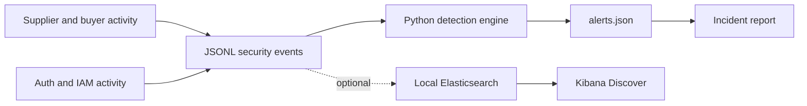

# TradeLink — Security Operations & Incident Response Lab

**A reproducible security-operations portfolio lab for a fictional cross-border B2B marketplace.** TradeLink connects US buyers with overseas suppliers. The scenario involves authentication anomalies, attempted cross-tenant order access, bulk export and unauthorized privilege changes.

> **Portfolio integrity:** All events and identities are synthetic. This is a personal educational lab, **not** a production deployment, professional employment or a live compromise. Five alerts come from a Python rules engine, not native Elastic Security rules or an EDR.

## What works

| Capability | Result |
|---|---|
| Synthetic telemetry | 90 deterministic JSONL security events |
| Detection engine | Five Python detections: TL-001–TL-005 |
| Investigation | Alert evidence, timeline and generated incident report |
| Validation | Five unit tests and GitHub Actions CI |
| Optional log exploration | Loopback-only Elasticsearch and Kibana via Docker Compose |

## Architecture



## Quick start

Python 3.10+ is required. The core workflow needs only the Python standard library; the editable installation uses setuptools.

```bash
python -m pip install -e .
tradelink-soc
python -m unittest discover -s tests -v
```

The CLI creates `outputs/events.jsonl`, `outputs/alerts.json` and `outputs/incident-report.md`. These generated files are gitignored. Without installing: `PYTHONPATH=src python -m tradelink.cli` on macOS/Linux, or `$env:PYTHONPATH='src'; python -m tradelink.cli` in PowerShell.

## Optional local Kibana

This is a **disposable local-only lab**. Authentication is disabled in the demo Elastic stack and both service ports bind to `127.0.0.1`. Do not expose it outside your computer.

```bash
docker compose -f config/docker-compose.yml up -d
python -m tradelink.elastic_ingest --input outputs/events.jsonl
```

Open `http://localhost:5601` and create a data view named `tradelink-security-lab` using `@timestamp`. Set the date range to include **2026-10-19**, the fixed scenario date. Example searches: [Elastic queries](docs/elastic-queries.md). Shut down with `docker compose -f config/docker-compose.yml down`.

**Note:** The Python program creates detections and reports; the optional Kibana instance is for searching events. Docker startup and native Elastic detection rules have not been independently verified as part of the Python test suite.

## Scenario

1. A baseline of ordinary supplier/buyer activity.
2. Nine failed logins from a new source followed by a successful login.
3. Three denied attempts to view another supplier's orders (HTTP 403).
4. A synthetic export of 1,500 records.
5. An unapproved admin role assignment.
6. Five correlated rule alerts and a case report with recommendations.

A 403 indicates a **blocked** cross-tenant access attempt, not successful data theft. A bulk-export event does **not** establish that data left the environment. See the [detection catalog](docs/detection-catalog.md) and [analyst playbook](docs/analyst-playbook.md).

## Repository structure

```text
src/tradelink/           Generator, detection engine, CLI, report, optional ingest
tests/                   Five regression tests
docs/                    Architecture, rule catalog, analyst playbook, KQL
config/                  Optional local Docker Compose
.github/workflows/       CI
outputs/                 Generated artifacts (ignored)
```

## Interview demonstration

Run `tradelink-soc`, review alert evidence IDs, reconstruct the timeline from raw logs and explain the different levels of certainty. Discuss false positives for unfamiliar IPs, authorization boundaries, why recommendation is not execution, and what extra telemetry would confirm external exfiltration.

**Suggested resume wording, only after reproducing it yourself:** “Built a reproducible SOC lab for a simulated multi-tenant B2B marketplace; generated normalized authentication/IAM/access telemetry, implemented and tested five detection rules, and correlated evidence into an incident report.”

## Roadmap (not yet implemented)

- [ ] Build a working Flask marketplace with real authorization checks.
- [ ] Add native Elastic Security or Sigma detection rules and captured dashboards.
- [ ] Connect AWS sandbox CloudTrail and WAF telemetry.
- [ ] Add analyst dispositions, false-positive measurements and tests.

## License

MIT — see [LICENSE](LICENSE).
