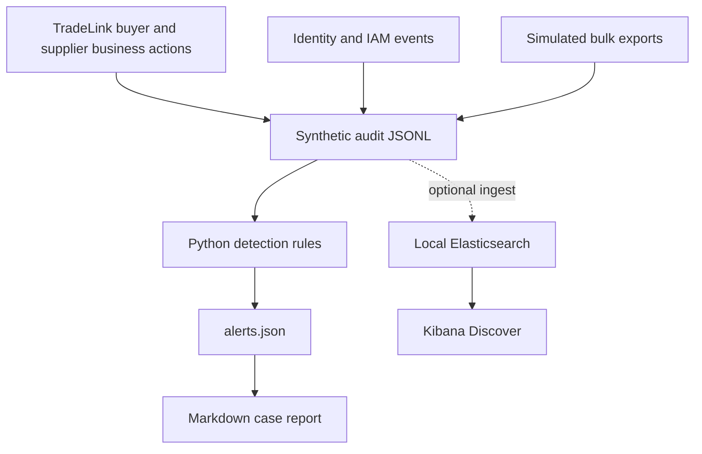

# Architecture and trust boundaries

## Business model

- Tenants: buyer and supplier organizations with independent order records.
- Identities: buyer, supplier and privileged administrator accounts.
- Assets: simulated buyer contact lists, order records and role assignments.
- Trust boundary: a supplier must not read another tenant's orders. Administrative permissions require separate approval.

## Implemented

Reproducible simulated events, ECS-like JSON fields, five Python alert rules, unit tests, evidence correlation and case reporting. Local Elastic ingest is optional.

## Not implemented

A production or hosted marketplace, AWS infrastructure, real identity-provider integration, endpoint telemetry, active containment actions, native Elastic alerting or deployed dashboards.

## Safety

Only synthetic users and RFC 5737 documentation IP ranges are used. Docker services bind to loopback; the Elastic demo disables authentication solely for a disposable local environment. Never expose those ports publicly.
